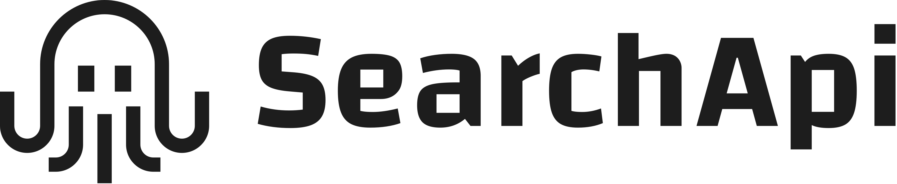

<p align="center">
  <picture>
    <source media="(prefers-color-scheme: dark)" srcset="assets/logo-white.png">
    
  </picture>
</p>

# SearchApi agent skills

Give your AI agent live search results as data: Google, Bing, Maps, Shopping, Flights, Hotels, News, YouTube, AI answers and 100+ more engines, for any country, language or city.

Two ways to connect. Pick one:

**API key:** for coding agents, scripts and batch jobs. Every engine, with each response trimmed and checked by the skill's script.

[](#install) [](https://www.searchapi.io/users/sign_up?utm_source=github&utm_medium=agent-skill&utm_campaign=searchapi-skill)

**MCP server:** for chat apps, or to try it without a key. One click, then sign in with OAuth.

[](https://claude.ai/customize/connectors?modal=add-custom-connector&connectorName=SearchApi&connectorUrl=https%3A%2F%2Fwww.searchapi.io%2Fmcp) [](https://cursor.com/install-mcp?name=searchapi&config=eyJ1cmwiOiJodHRwczovL3d3dy5zZWFyY2hhcGkuaW8vbWNwIn0%3D) [](https://insiders.vscode.dev/redirect/mcp/install?name=searchapi&config=%7B%22type%22%3A%22http%22%2C%22url%22%3A%22https%3A%2F%2Fwww.searchapi.io%2Fmcp%22%7D) [](#add-the-mcp-server)

## Why use this skill

Your agent's built-in web search returns a short list of links with a sentence of text each. It can't choose the country or city, it doesn't show rankings, prices, ratings, maps or ads, and when your agent tries to open Google, Amazon or Maps itself, it gets blocked. SearchApi fetches those pages for it and returns them as clean JSON. This skill teaches your agent to use it well:

- **Right answers, fewer credits.** In our tests the agent got 100% of answers right with the skill, against 88% without, and used 48% fewer SearchApi credits.
- **Far fewer tokens.** The skill's script strips base64 images and dead weight before your agent reads a response, without dropping a single result. That's about a third of a Google or Bing results page in our tests, and over 80% when a page carries inline images. Big responses become a short list of fields the agent picks from, and the full response is saved so re-reading it costs nothing.
- **Search data your agent can't get on its own.** Google, Bing, Maps, Shopping, Amazon, Flights, Hotels, News, YouTube, ad libraries and AI answers from ChatGPT, Gemini and Google AI Mode, for any country, language or city. SearchApi handles the proxies, CAPTCHAs and parsing.
- **Structured data you can trust.** Positions, prices, ratings, dates and links come back as fields, not prose. The script catches errors hidden in "successful" responses, params the API ignored or replaced, and locations that resolved to the wrong city.
- **Built for scale.** Put your queries in a file and run them as one batch: 5 at a time, with safe retries, one summary table and a credit check before it starts.
- **The right engine first time.** A route table covers rankings, local businesses, prices, flights, news, AI answers and ads, and the script reads each engine's params live.
- **Safe by default.** Your key goes only in a header, and results are treated as data, never as instructions.

## Install

**Any agent (start here):**

```bash
npx skills add searchapi/agent-skills
```

The [skills CLI](https://github.com/vercel-labs/skills) asks which skills to install and for which agents. Add `-y` to install both skills for every agent it finds, or pick agents with `-a`, for example `-a claude-code -a codex`. To install by hand, copy `skills/searchapi` and `skills/searchapi-migrate` into `.claude/skills/` (Claude Code), `.agents/skills/` (Codex) or `.kiro/skills/` (Kiro). The migrate skill uses the core skill's script, so install both.

| Agent | Install |
|---|---|
| Claude Code | `/plugin marketplace add searchapi/agent-skills`, then `/plugin install searchapi@searchapi` |
| Claude (web and desktop) | Customize, Plugins, Add, Add marketplace: `searchapi/agent-skills`, then add SearchApi and connect it on the plugin's Connectors tab. It syncs to Cowork and Claude Code |
| Codex | `codex plugin marketplace add searchapi/agent-skills`, then `codex plugin add searchapi@searchapi` |
| Cursor | Cursor Marketplace (coming soon), or `npx skills add searchapi/agent-skills -a cursor` |
| Gemini CLI | `gemini extensions install https://github.com/searchapi/agent-skills`, then `/mcp auth searchapi` in Gemini to sign in to the MCP server |
| GitHub Copilot CLI | `copilot plugin marketplace add searchapi/agent-skills`, then `copilot plugin install searchapi@searchapi` |
| Kiro | `npx skills add searchapi/agent-skills -a kiro-cli` |
| Hermes Agent | `hermes skills install searchapi/agent-skills/hermes/searchapi` and `hermes skills install searchapi/agent-skills/hermes/searchapi-migrate`. Connect with the skill's `setup` command. The Hermes copy reads only the saved key file (Hermes's scanner blocks scripts that read a key from the environment); a `SEARCHAPI_API_KEY` you already set gets saved there once |
| OpenClaw | `npx skills add searchapi/agent-skills -a openclaw -g` (`-g` puts it in `~/.openclaw/skills`; OpenClaw does not read the current folder) |
| Grok Build | `grok plugin install searchapi/agent-skills --trust` (`--trust` is required: without it Grok stops before installing) |

Use one install route per agent. Two routes (for example the skills CLI and an agent's own installer) give the agent two copies of each skill.

### Ask your agent to install it

Paste this into any coding agent:

```text
Install the SearchApi agent skills from https://github.com/searchapi/agent-skills.
Use this agent's plugin install if it has one, otherwise run: npx skills add searchapi/agent-skills
Then run the searchapi skill's Connect step and tell me when SearchApi is connected.
```

## Connect

Ask your agent for the API or MCP and the skill uses that. Otherwise it uses your key if one is set up, then the SearchApi MCP server if your agent has one. With neither, it asks you:

1. **I have a key.** Your agent gives you one command to run in your own terminal, with the full path of the installed skill, for example:

   ```bash
   python3 ~/my-project/.claude/skills/searchapi/scripts/searchapi.py setup
   ```

   Paste the key at the hidden prompt. It saves the key to `~/.config/searchapi/key` (only you can read it) and checks it. Setting `SEARCHAPI_API_KEY` works too. On Windows, use `py` instead of `python3`.
2. **I need a key.** [Sign up for SearchApi](https://www.searchapi.io/users/sign_up?utm_source=github&utm_medium=agent-skill&utm_campaign=searchapi-skill), then do step 1.
3. **Use MCP.** Use a button at the top, or the steps in [Add the MCP server](#add-the-mcp-server). It signs in with OAuth, no key to copy.

## Add the MCP server

The buttons at the top add the SearchApi MCP server, `https://www.searchapi.io/mcp`, in one click to Claude, Cursor and VS Code. It signs in with OAuth, so there is no key to copy. The Claude Code, Cursor and Gemini CLI plugins in this repo already include it; with a key set up, the skill still uses the key. For the rest:

| Assistant | Add it |
|---|---|
| VS Code Insiders | [One click](https://insiders.vscode.dev/redirect/mcp/install?name=searchapi&config=%7B%22type%22%3A%22http%22%2C%22url%22%3A%22https%3A%2F%2Fwww.searchapi.io%2Fmcp%22%7D&quality=insiders) |
| Visual Studio | [One click](https://vs-open.link/mcp-install?%7B%22name%22%3A%22searchapi%22%2C%22type%22%3A%22http%22%2C%22url%22%3A%22https%3A%2F%2Fwww.searchapi.io%2Fmcp%22%7D) |
| Kiro | [One click](https://kiro.dev/launch/mcp/add?name=searchapi&config=%7B%22url%22%3A%22https%3A%2F%2Fwww.searchapi.io%2Fmcp%22%7D) |
| LM Studio | [One click](https://lmstudio.ai/install-mcp?name=searchapi&config=eyJ1cmwiOiJodHRwczovL3d3dy5zZWFyY2hhcGkuaW8vbWNwIn0%3D) |
| Goose | [One click](https://goose-docs.ai/extension?url=https%3A%2F%2Fwww.searchapi.io%2Fmcp&type=streamable_http&id=searchapi&name=SearchApi&description=Live%20search%20results%20as%20data%20from%20Google%2C%20Bing%2C%20Maps%20and%20100%2B%20engines) |
| Claude Code | `claude mcp add --transport http --scope user searchapi https://www.searchapi.io/mcp`, then run `/mcp` to sign in |
| ChatGPT | On chatgpt.com/plugins, click **+**, then **Add custom MCP server**: URL `https://www.searchapi.io/mcp`, authentication OAuth, then **Create as a plugin** |
| Codex | `codex mcp add searchapi --url https://www.searchapi.io/mcp` (it starts the OAuth sign-in) |
| Gemini CLI | `gemini mcp add --transport http --scope user searchapi https://www.searchapi.io/mcp` |
| Windsurf (Devin Desktop) | `devin mcp add -s user searchapi https://www.searchapi.io/mcp`, then `devin mcp login searchapi` |
| Any other MCP client | Remote server `https://www.searchapi.io/mcp`, Streamable HTTP, OAuth |

On Claude Team and Enterprise plans, an Owner adds it once for everyone under Organization settings, Connectors.

## Usage

Ask in plain words. The skill picks the engine and the params.

- "Who ranks for 'running shoes' in the UK? Give me the top 10 with links."
- "Find dentists in Leeds rated 4.5 or higher, with phone numbers."
- "Cheapest flights from London to Lisbon next Friday."
- "Is our brand cited by ChatGPT, Gemini and Google AI Mode for 'best crm'?"
- "Move this project from SerpApi to SearchApi." (the `searchapi-migrate` skill)

| Command | Does |
|---|---|
| `/searchapi:setup` | Connects SearchApi (MCP or key) and checks it |
| `/searchapi:credits` | Credits left and searches this hour |
| `/searchapi:search` | One search with the skill's rules |
| `/searchapi:migrate` | Moves SerpApi, Serper, DataForSEO or Bright Data code to SearchApi |

Claude Code shows these names. Gemini CLI and Grok load them as `/setup`, `/credits`, `/search` and `/migrate`, and Cursor loads them too. Copilot CLI and Codex have no plugin commands, so there the skills trigger on what you ask.

For agents that skip skills, one line in your project's `AGENTS.md` or `CLAUDE.md` helps:

```text
For live search data use the `searchapi` skill; run heavy or multi-query jobs through its script and never read raw SearchApi JSON.
```

## Data and network

The skills are instructions plus one script, `skills/searchapi/scripts/searchapi.py` (Python standard library, no dependencies). The script talks only to `www.searchapi.io`:

| Request | When | Cost |
|---|---|---|
| `GET /api/v1/search` (a `POST` with the same params only when a query is too long for a URL) | Every search | Credits, for successful searches only; failed calls are free |
| `GET /api/v1/me` | `credits`, `setup`, and before a `batch` | Free |
| `GET /api/v1/locations` | `locations`, to find a valid `location` name | Free |
| `GET /openapi/ENGINE.yaml` | `params`, to list an engine's params (public file, no key sent) | Free |

- **Your key** comes from `SEARCHAPI_API_KEY` or `~/.config/searchapi/key` (mode 0600). It goes only in the `Authorization: Bearer` header, never in a URL, never in output, and never to another host: redirects are not followed.
- **One extra header** goes with each API call: `X-SearchApi-Client: searchapi-skills/1.0.0 (<agent>; <skill>)` (the same string is the `User-Agent`). It names the skill version, the agent when the script can tell from its environment (for example `claude-code` or `codex`, else `unknown`), and which skill made the call.
- **Raw responses** are saved untouched to a private `searchapi/` folder in the system temp folder (or `SEARCHAPI_DIR`), files mode 0600, never in your repo, so the agent can re-read them without paying again.
- **Nothing else** is sent or collected: no telemetry, no prompts, no file contents, no machine details.
- **The MCP server** (`https://www.searchapi.io/mcp`) is used by your agent's own MCP client with OAuth sign-in; the script does not touch it.

## Configuration

| Setting | Default | What it does |
|---|---|---|
| `SEARCHAPI_API_KEY` | unset | Your key. Used before the saved key file (on Hermes, saved to the key file once) |
| `~/.config/searchapi/key` | written by `setup` | The saved key, mode 0600 |
| `SEARCHAPI_DIR` | a private `searchapi/` folder in the system temp folder | Where the script saves untouched raw responses |
| `SEARCHAPI_BASE_URL` | unset | Tests only: a local mock URL. Any host other than localhost is refused |

The MCP server needs no local settings.

## What is in the repo

| Path | What |
|---|---|
| `skills/searchapi/` | The core skill: `SKILL.md`, `scripts/searchapi.py` (Python 3.8+, standard library only), `agents/openai.yaml` |
| `skills/searchapi-migrate/` | The migration skill and `references/mapping.md` |
| `commands/` | The 4 slash commands (`.md`), plus generated `.toml` copies for Gemini CLI |
| `hermes/`, `clawhub/` | Generated copies for Hermes and ClawHub (`python3 build/variants.py`) |
| `.claude-plugin/`, `.cursor-plugin/`, `.agents/plugins/`, `plugin.json`, `.mcp.json`, `mcp.json`, `gemini-extension.json` | Plugin manifests and MCP config for Claude Code, Cursor, Codex, Grok, Copilot, Kiro and Gemini CLI |
| `assets/` | logo.png and logo-white.png (wordmark for light and dark themes) and icon.png (512 px square, for listings) |
| `build/lint.py`, `tests/` | Lint and offline tests against saved real responses and a local mock (no network, no credits) |

```bash
python3 build/lint.py
python3 -m unittest discover -s tests
```

## Docs and support

- API docs per engine: [Google](https://www.searchapi.io/docs/google), [Google Maps](https://www.searchapi.io/docs/google-maps), [Google Shopping](https://www.searchapi.io/docs/google-shopping), [Google News](https://www.searchapi.io/docs/google-news), [Google Flights](https://www.searchapi.io/docs/google-flights-api), [Google AI Mode](https://www.searchapi.io/docs/google-ai-mode-api), [Google rank tracking](https://www.searchapi.io/docs/google-rank-tracking-api), [YouTube](https://www.searchapi.io/docs/youtube). The script reads each engine's params live with `params ENGINE`.
- Problems with the skills: [open an issue](https://github.com/searchapi/agent-skills/issues). Account or API questions: support@searchapi.io. Security reports: see [SECURITY.md](SECURITY.md).
- [Privacy policy](https://www.searchapi.io/legal/privacy), [terms](https://www.searchapi.io/legal/terms). SearchApi is ISO 27001:2022 certified ([Trust Center](https://security.searchapi.io)).

## License

MIT. Copies published on ClawHub are MIT-0, which ClawHub applies to every skill.
